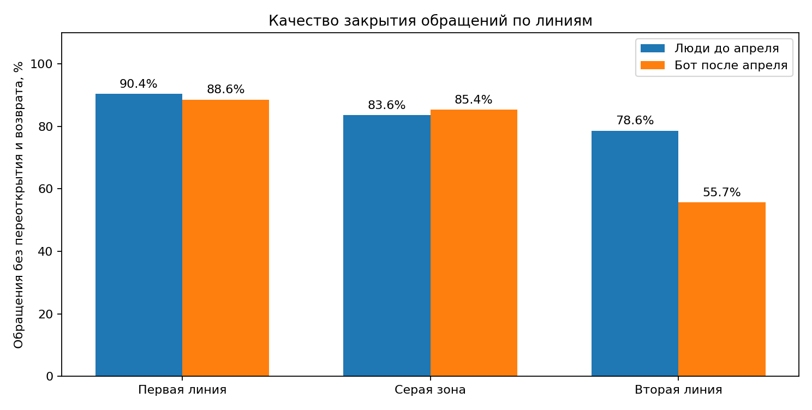

# Анализ эффективности бота поддержки

**SQL, SQLite, очистка данных, сегментация обращений, оценка качества сервиса**

Проект на учебной выгрузке обращений за январь-июнь 2025 года. С апреля в письменных каналах начал отвечать бот. Хотела проверить, насколько хорошо он справляется с простыми и сложными обращениями и стоит ли передавать ему вторую линию.

## Основные результаты

- В исходных данных нашла 273 полных дубля, два формата дат и неоднозначно записанные пропуски.
- Разделила обращения на первую, вторую линии и серую зону по теме, приоритету и времени обработки.
- На второй линии у людей до апреля 78,6% обращений проходили без переоткрытия и возврата. Среди закрытых ботом после апреля таких обращений 55,7%.
- Если серую зону отнести ко второй линии, показатель бота составит 72,0%. Это показывает, насколько результат зависит от определения сложности обращения.



## Вывод

Боту стоит оставить типовые вопросы первой линии. Сложные обращения лучше направлять специалистам. Серую зону можно проверять отдельно по темам. Быстрый первый ответ не гарантирует решения проблемы клиента.

## Материалы

- [Проверка данных](analysis/01_data_quality.md)
- [Сегментация](analysis/02_segments.md)
- [Оценка работы бота](analysis/03_bot_quality.md)
- [Итоговая аналитическая записка](analysis/04_summary.md)

## Как проверить SQL

В `data/` лежат учебные CSV и разметка тем. Достаточно Python 3, без дополнительных библиотек:

```bash
python3 scripts/run_queries.py analysis/03_bot_quality.md
```

`load_data.py` приводит даты и каналы к единому виду, убирает полные дубли, отмечает повторные обращения и загружает CSV во временную SQLite-базу. `run_queries.py` выполняет запросы из выбранного Markdown-файла.
