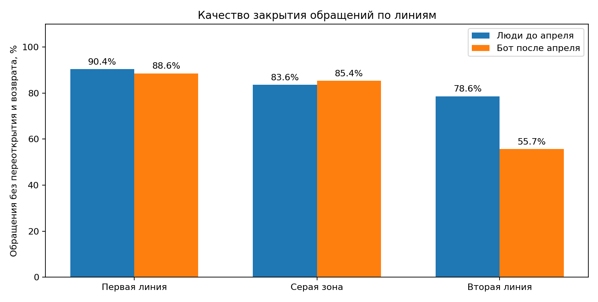

# Аналитическая записка

## Вывод

Оставила бы боту первую линию. Вторую линию лучше передавать специалистам: у людей до апреля 78,6% письменных обращений завершались без переоткрытия и возврата, у обращений второй линии, закрытых ботом после апреля, только 55,7%.

## Как считала

Исследовала выгрузку за январь-июнь 2025 года. В ней было 7033 строки и 6760 уникальных обращений после удаления полных дублей. Привела каналы и даты к единому виду, разделила темы по медианному времени обработки и приоритету. Серая зона составляет 758 обращений после апреля, или 21,4% от всех обращений периода. При оценке возвратов учитывала, что неизвестные темы не позволяют надежно связать повторные тикеты.

## Два сценария

| Сценарий | Люди до апреля | Доля закрытых ботом | Решено среди закрытых ботом |
|---|---:|---:|---:|
| Серая зона как вторая линия | 80,7% | 47,2% | 72,0% |
| Серая зона как первая линия | 78,6% | 37,7% | 55,7% |

Даже при более мягкой границе сравнение не становится однозначно положительным для бота.

## Что говорит против

На первой линии у бота 88,6% обращений без переоткрытия и возврата, практически на уровне людей до апреля (90,4%). Он сильно ускорил первый ответ в письменных каналах. Но во второй линии сложность обращений выше, значит, быстрый ответ может не решить сам вопрос.

## Чего не хватает

Не хватает текста переписки и причин повторного обращения. Без них невозможно оценить качество ответа напрямую. Также в нумерации пропущено 32 номера до апреля и 155 после. Это не доказывает потерю обращений, но не позволяет считать выгрузку абсолютно полной. Последние семь дней июня имеют неполное окно для поиска возвратов, поэтому итоговая доля успеха может быть немного завышена.

## Сравнение качества



### Главное число

```sql
select
    round(avg(reopened = 0 and came_back = 0) * 100, 1) as bot_fcr
from razmetka
where period = 'после'
  and written = 1
  and blok = 'вторая'
  and bot_result = 'закрыл'
```
